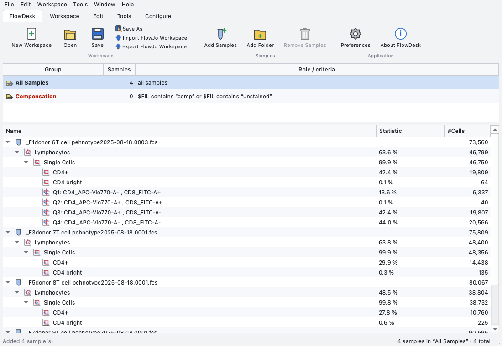
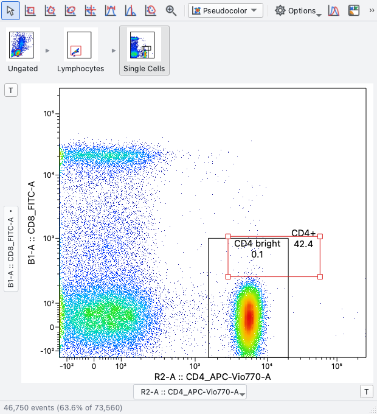
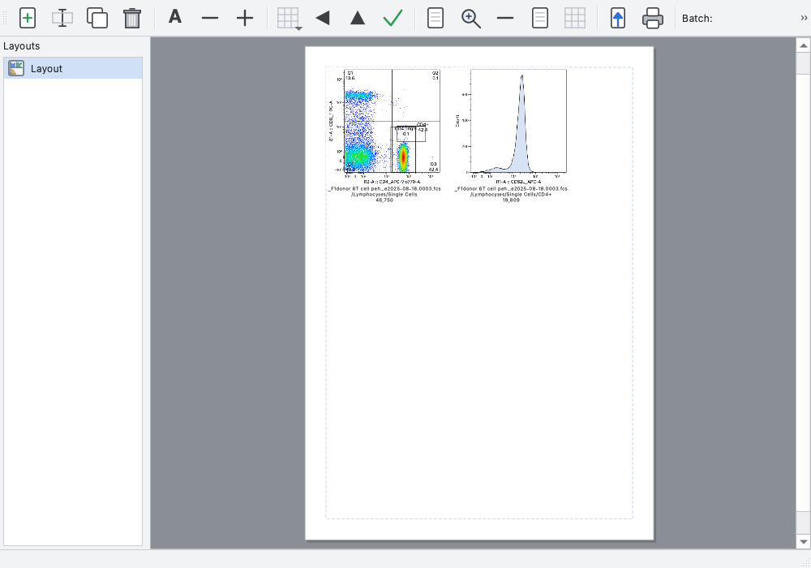

# FlowDesk

FlowDesk is a desktop workspace for flow cytometry analysis. It follows the
workflow experienced cytometrists already know: a **workspace** with sample
**groups** and a gating tree, **graph windows** where gates are drawn on
pseudocolor, contour or histogram plots, a **Layout Editor** for figures, a
**Table Editor** for batch statistics, and a **compensation** editor with a
wizard that computes spillover from single-stain controls.

It is an independent, original implementation built from the public standards
(FCS 2.0/3.0/3.1, ISAC Gating-ML 2.0, the logicle "biexponential" scale of
Parks, Roederer & Moore). It also imports and exports FlowJo™ workspace
files (`.wsp`), so existing analyses can be opened directly. FlowJo is a
trademark of its owner; FlowDesk is not affiliated with it.

## Running

```bash
cd FlowDesk
uv venv --python 3.12 .venv            # or: python3.12 -m venv .venv
uv pip install --python .venv/bin/python -e .   # or: .venv/bin/pip install -e .
.venv/bin/python -m flowdesk           # or: ./flowdesk.sh
```

Open an FCS file, a folder, a `.fdw` workspace or a FlowJo `.wsp` file by
passing it on the command line or by dropping it onto the workspace window.

## The workflow

| Where | What you do |
|---|---|
| **Workspace window** | Add samples (`Add Samples`, `Add Folder`, or drag FCS files in). The group pane lists *All Samples*, the automatic *Compensation* group and your own groups. The sample list shows each sample's gating tree with the *Statistic* (% of parent) and *#Cells* columns, plus any keyword columns you add (`Edit Columns…`). |
| **Graph window** | Double-click a sample or population. Choose the x/y parameters with the axis buttons (or `⌘/Ctrl + arrow keys`), the plot type (Pseudocolor, Dot, Contour, Zebra, Density, Histogram) and draw gates with the tools: Rectangle, Polygon, Ellipse, Quadrant, Range, Bisector, Freehand. Double-click inside a gate to open it. `T` buttons customise the axis scale (linear / biexponential / log / arcsinh). The ancestry strip shows the parent gates. |
| **Groups** | Drag populations onto a group (or `Apply to Group`) to copy gates to every sample of the group. Gates drawn in a *group graph window* (double-click a group) apply to all its members. New samples that join a group receive its gates. |
| **Statistics** | `Add Statistic…` adds Median/Mean/CV/… rows below populations; Boolean AND/OR/NOT gates combine populations. |
| **Layout Editor** | Drag populations from the workspace onto the page, arrange, overlay (drop onto an existing plot), export PNG/PDF/SVG, and create a batch PDF with one page per sample. |
| **Table Editor** | Define columns (population × statistic, keyword columns), run them over a group, export CSV or copy to the clipboard. |
| **Compensation** | The matrix stored in each FCS file is applied automatically (`Comp-` parameters). Edit matrices, apply to groups, or run the Compensation Wizard on the Compensation group's controls. |

Workspaces are saved as `.fdw` (JSON). `File ▸ Export FlowJo Workspace…`
writes a `.wsp`. Populations can be exported as new FCS files or CSV.

## Coming from FlowJo

| You did this in FlowJo | In FlowDesk |
|---|---|
| Drag FCS files into the workspace | Same (or `Add Samples` / `Add Folder`) |
| Double-click a sample / population to get a graph window | Same (`⌘G` on a selection) |
| Gate tools in the graph window toolbar | Same tools, same order; shortcuts V R P E Q H B F Z |
| Click the axis name to pick a parameter; `Ctrl`+arrows to cycle | Same (`⌘`/`Ctrl` + arrows) |
| `T` button to change the transform (width basis, extra negative decades…) | Same `T` button, same parameters |
| Double-click inside a gate to drill down | Same |
| Drag a gate onto a group to apply it to all samples; group graph windows | Same; the group pane accepts drops and double-clicking a group opens its graph |
| Ancestry strip | Same |
| Add Statistic, Boolean gates (AND/OR/NOT), keyword columns, keyword groups | Same, in the Workspace ribbon tab |
| Layout Editor: drag populations onto the page, overlays, batch | Same; overlays by dropping onto a plot; batch PDF |
| Table Editor: drag populations in, pick statistics, run on a group | Same; CSV export and clipboard |
| Compensation matrix editor and wizard | Same (Tools ribbon tab) |
| Export populations as FCS, concatenate samples | Same (File / Tools) |
| Open `.wsp` workspaces | `File ▸ Open` reads `.wsp` directly; `Export FlowJo Workspace…` writes one |

How close are the numbers? Importing real FlowJo workspaces and recomputing
every population: rectangle, quadrant and range gates reproduce FlowJo's stored
counts exactly; polygon gates differ by at most 0.7 % because FlowJo evaluates
polygons on a 256-bin display grid while FlowDesk evaluates them exactly.
`Preferences ▸ Gates ▸ Polygon gates ▸ FlowJo-compatible (bitmap)` switches to
a binned evaluation that mimics FlowJo; measured over all 40 gates of the
T-cell workspace it brings the difference to FlowJo's stored counts from
rms 0.51 % (systematic −0.39 %) to rms 0.30 % (no bias), worst gate 1.32 % →
1.17 %. Plots use the same conventions: `name :: stain` axis titles,
`50K`/`10³` tick labels, pseudocolor density, gate names with percentages.

### Verified interoperability

* **FlowJo opens FlowDesk's exported workspaces.** A workspace imported from
  `19-Aug-2025.wsp`, exported again by FlowDesk and opened in FlowJo 10.10.0
  shows the same groups, samples and gating tree
  (`docs/exported_wsp_opened_in_flowjo.png`; population counts are blank there
  only because that FlowJo installation has no active licence).
* **FlowKit agrees.** The independent FlowKit parser reads the FlowDesk export
  and computes identical counts to the original FlowJo file for all 40 gates
  of the T-cell workspace; its own deviation from FlowJo's stored counts
  (max 1.3 %) is the same as FlowDesk's, and it reproduces FlowDesk's polygon
  counts on linear axes exactly.

A step-by-step FlowJo-style session with a screenshot per step, and a
ten-minute acceptance check, is in [docs/WALKTHROUGH.md](docs/WALKTHROUGH.md).

## Screenshots

| | |
|---|---|
|  |  |
| Workspace window: ribbon, group pane, sample tree | Graph window: gate tools, ancestry, axis selectors |
|  |  |
| Pseudocolor, dot, contour, zebra, density, histogram, quadrants | Layout Editor |

`docs/flowjo_workspace_rendered.png` is a layout generated from a real FlowJo
workspace (`19-Aug-2025.wsp`) imported into FlowDesk; it reproduces the gates
and percentages of the figure FlowJo exported for the same analysis.

## Tests

```bash
QT_QPA_PLATFORM=offscreen .venv/bin/python -m pytest -q
```

The test-suite includes comparisons against the population counts stored in
real FlowJo workspaces (identical for rectangle gates, within ~1 % for polygons).

## Layout of the code

```
flowdesk/core      fcs.py (reader/writer), transforms.py (scales), gates.py, stats.py,
                   compensation.py, model.py (workspace/sample/population/group),
                   layouts.py, serialization.py, wsp_import.py, wsp_export.py
flowdesk/ui        main_window.py (ribbon, groups, sample tree), graph_window.py,
                   plot_widget.py (gate drawing/editing), renderer.py (plots),
                   layout_editor.py, table_editor.py, compensation.py, dialogs.py,
                   icons.py (drawn icons), style.py, controller.py (signals/undo/prefs)
tests              pytest suite (core + UI, run offscreen)
```
