<div align="center">


# FlowDesk

**Flow cytometry analysis on the desktop: gate, compensate, lay out figures and cluster, and open your FlowJo workspaces as they are.**

A workspace with sample groups and gating trees, graph windows, a Layout Editor, a Table Editor, a compensation wizard,
t-SNE / UMAP / FlowSOM / Phenograph, cell-cycle, proliferation and quality-control tools. One independent, original
Python and Qt application for macOS, Windows and Linux.

[](https://github.com/Jetzu/FlowDesk/actions/workflows/ci.yml)


</div>

```bash
flowdesk "19-Aug-2025.wsp"        # a FlowJo workspace, a .fdw, a folder of FCS files, or nothing
```

<p align="center">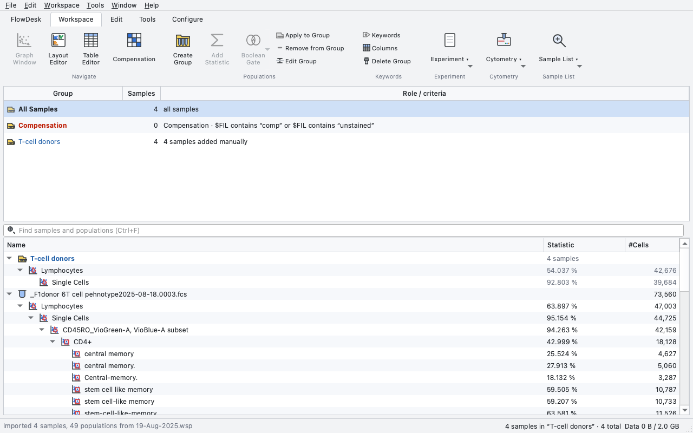</p>

The screenshots in this README were rendered by FlowDesk itself, on a real T-cell phenotyping panel and on real
single-stain controls; the ones marked *synthetic* use generated test data (DNA-content histograms, beads, a 96-well plate).
[docs/make_gallery.py](docs/make_gallery.py) regenerates the ones in `docs/images`.

## Gallery

### Gating

> *Gate lymphocytes on FSC / SSC, single cells on FSC-A / FSC-H, then split CD4 and CD8 with a quadrant gate.*

Rectangle, polygon, ellipse, quadrant, range, bisector and freehand gates, drawn on pseudocolor, dot, contour, zebra,
density or histogram plots, with the same tools, order and letter shortcuts as FlowJo. Axes are linear, logicle
(biexponential), logarithmic or arcsinh, with the `T` dialog for width basis and decades.

<p align="center">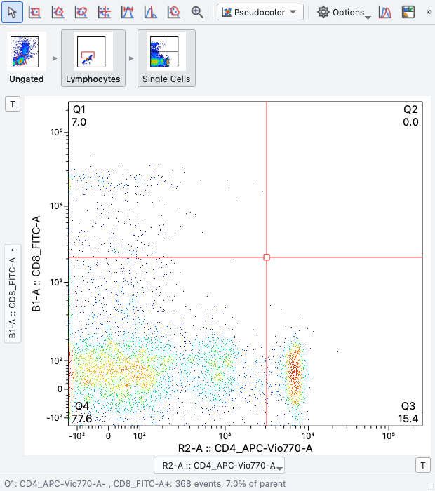</p>
<p align="center">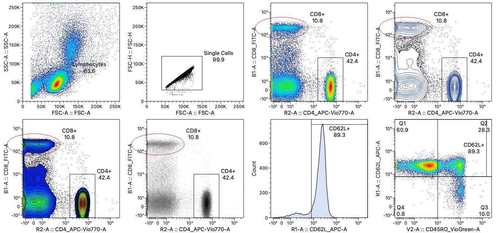</p>

### Groups and the workspace

> *Drag the CD62L+ gate onto the "donors" group so every sample gets it, then add the median of CD4 as a statistic.*

Groups carry a gating template that new members inherit. Keyword groups are live, FCS files dropped on a group join it,
gates move between parents by dragging, and every change is one undo step. The sample list can be sorted by any
column, filtered (Ctrl+F), renamed in bulk and grouped by keyword.

<p align="center">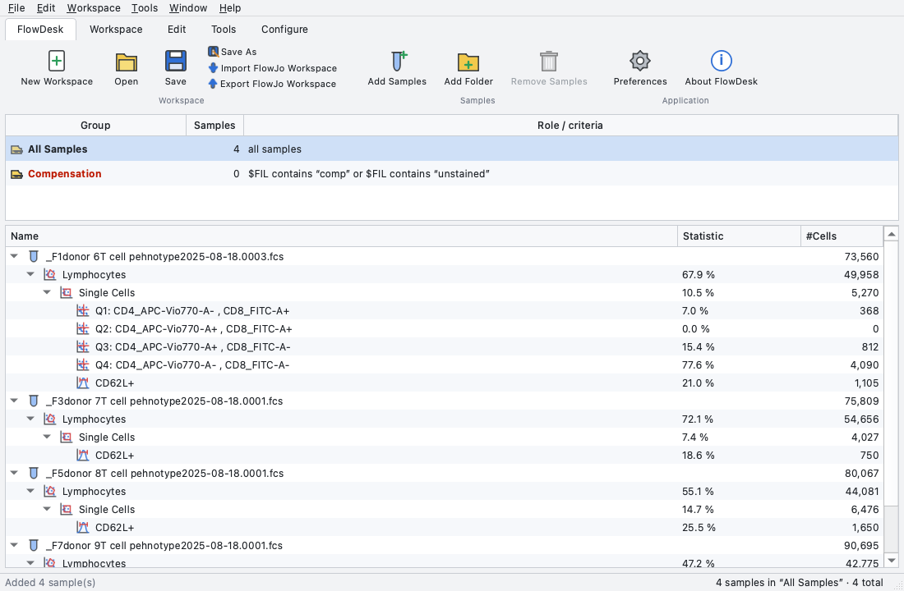</p>

### Compensation

> *Compute the spillover matrix from the single-stain controls, check the diagnostics, and attach it to the group.*

A four-page wizard (controls, gates, matrix, diagnostics) with positive and negative gates per control, a robust
AutoSpill-style refinement, the spillover spreading matrix and a control-plot panel for adjusting cells by eye.
On real controls it lands within 1.3 points of FACSDiva's matrix (3 colours) and within 0.3 points of CytExpert's for the
seven well-stained tubes of an 8-colour panel; a dim control is flagged as weak instead of silently trusted.
Matrices import and export as `.mtx`, CSV or from another FCS file.

<p align="center">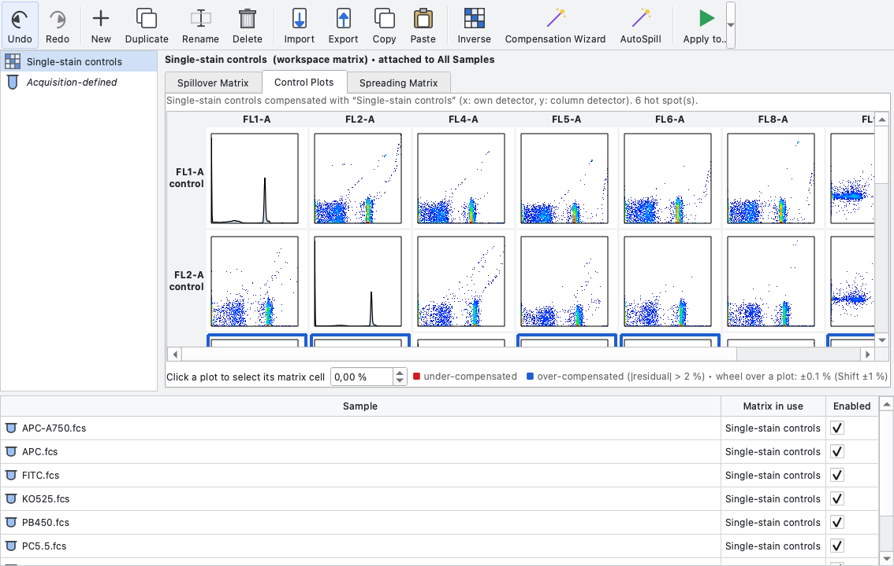</p>

### Figures and tables

> *Put the CD4 / CD8 plot of every donor on one page each, with the sample name and the cell count underneath, and export a deck.*

The Layout Editor aligns and distributes objects, overlays populations by dropping them on a plot, iterates over a group
or a keyword, and exports PNG, PDF, SVG or PowerPoint. The Table Editor runs population-by-statistic columns over a group
and copies or exports the result.

<p align="center">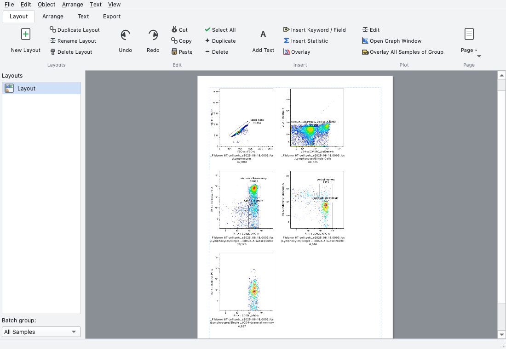</p>
<p align="center">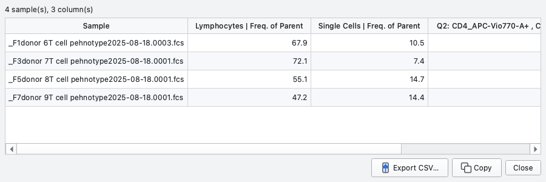</p>

### Dimensionality reduction and clustering

> *Run t-SNE on CD4+ T cells from all four donors, cluster with FlowSOM, and gate on the clusters.*

t-SNE, UMAP and PCA write their axes back as parameters you can gate on. FlowSOM-style, Phenograph and k-means clustering
create one population per cluster plus a median heat-map. *Project onto Existing…* places further samples on an earlier
PCA, FlowSOM or k-means result without recomputing.

<p align="center">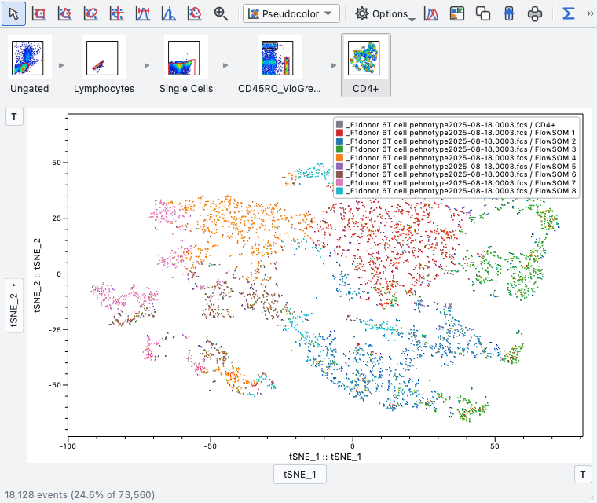 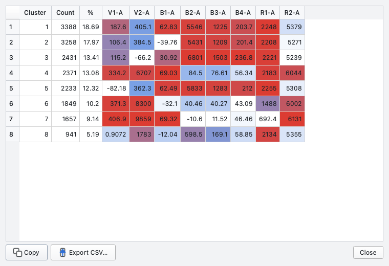</p>

### Cell cycle, proliferation and quality control

> *Fit the cell cycle with the Watson model including debris and doublets; model the CellTrace dilution; remove the unstable start of the run.*

Cell cycle (Dean-Jett-Fox or Watson, optional debris and aggregates), proliferation (generations, division, proliferation
and expansion index, generation 0 from an undivided control) and kinetics each run over a group and appear as table
statistics. Data cleaning checks flow rate, signal stability, change points and saturation; MESF calibration turns bead
peaks into a `<parameter> MESF` axis.

<p align="center">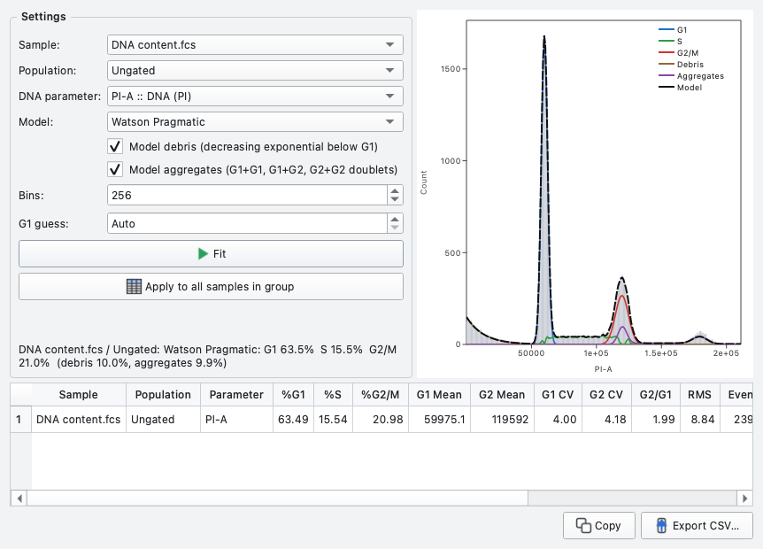 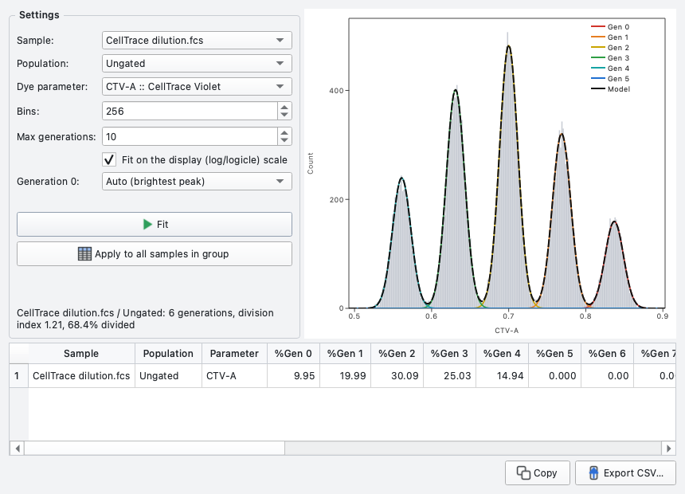</p>
<p align="center">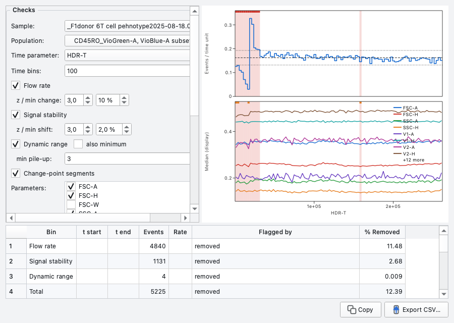 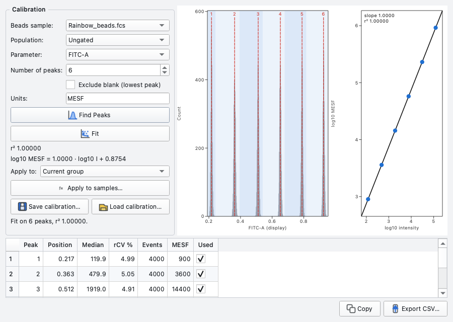</p>

### Experiments and plates

> *Colour the 96-well plate by the CD3+ frequency and group the wells of column 4.*

Annotate the experiment and its panel, add keywords from a file name or a CSV table, and view or design the plate: wells
come from `$WELLID` or the file name, are coloured by any statistic, selected by row or column, and filled with a
series (10, 20, 40 ...). Whole analyses travel as templates.

<p align="center">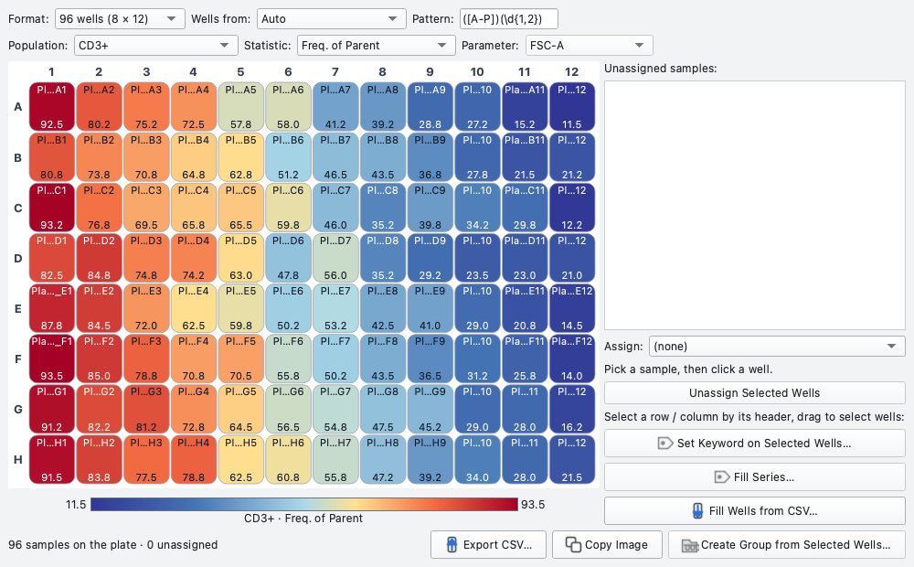</p>

## What it can do

| | |
|---|---|
| **Gate** | seven gate tools, Boolean AND / OR / NOT, quadrants, drill-down, ancestry strip, overlays and back-gating, tint and lock |
| **Compensate** | acquisition matrices, matrix editor with undo, wizard from controls, AutoSpill refinement, spreading matrix, `.mtx` and CSV |
| **Present** | Layout Editor (align, distribute, batch, PDF / SVG / PNG / PowerPoint), Table Editor (batch statistics, CSV), plot export |
| **Explore** | t-SNE, UMAP, PCA, FlowSOM, Phenograph, k-means, cluster populations, projection of new samples, population comparison (chi-squared T(x), KS) |
| **Measure** | 20+ statistics, cell cycle, proliferation, kinetics, derived parameters, fit results as table statistics |
| **Clean and calibrate** | flow-rate, signal-stability and saturation checks, a "QC pass" population, MESF bead calibration |
| **Organise** | keyword columns and groups, plate editor, cytometer default scales, experiment annotation, templates (`.fdwt`) |
| **Exchange** | FlowJo `.wsp` and `.wspt` in and out, FCS and CSV export, workspaces as readable JSON (`.fdw`) |
| **Extend** | every tool is a Python module with `install(window)`; a broken module never stops the window from opening |

Everything is undoable (gates, keywords, sample order, parameters, matrices, layouts and tables), and a
[feature-by-feature comparison with FlowJo](docs/PARITY.md) lists what is covered and what is not.

## Install

**macOS (Apple Silicon).** Build the disk image on the Mac you will use it on:

```bash
git clone git@github.com:Jetzu/FlowDesk.git && cd FlowDesk
python3 -m venv .venv && .venv/bin/python -m pip install -e ".[analysis,packaging]"
.venv/bin/python packaging/build.py --dmg      # writes dist/FlowDesk-<version>-macOS-arm64.dmg
```

Open the `.dmg` and drag **FlowDesk** onto **Applications**. The app is ad-hoc signed but not notarised, so a copy that
was downloaded rather than built locally needs one confirmation the first time: right-click, **Open**, **Open**
(or `xattr -dr com.apple.quarantine /Applications/FlowDesk.app`). Pushing a tag `v*` runs the release workflow, which
attaches the same disk image for macOS and zipped apps for Windows and Linux to the GitHub release.

**Windows and Linux.** Download the zipped app from a release, or run from source; step-by-step instructions, including
the Qt libraries needed on Linux, are in [docs/INSTALL.md](docs/INSTALL.md).

**From source (any platform).** The launchers create the virtual environment on first run:

```bash
./flowdesk.sh            # macOS / Linux  (Finder: double-click FlowDesk.command)
flowdesk.bat             # Windows        (double-click in Explorer)
```

Requirements: Python 3.11+ (3.12 recommended). t-SNE and UMAP use `openTSNE` and `umap-learn` when installed
(`pip install -e ".[analysis]"`); without them t-SNE falls back to scikit-learn and UMAP is disabled.

## Coming from FlowJo

| You did this in FlowJo | In FlowDesk |
|---|---|
| Drag FCS files into the workspace | Same (or `Add Samples` / `Add Folder`) |
| Double-click a sample or population for a graph window | Same (`⌘G` on a selection) |
| Gate tools in the graph toolbar | Same tools, same order; shortcuts V R P E Q H B F Z |
| Click the axis name to pick a parameter; `Ctrl` + arrows to cycle | Same |
| `T` button for the transform | Same button, same parameters |
| Drag a gate onto a group to apply it to all samples | Same; the group pane accepts drops and double-clicking a group opens its graph |
| Layout Editor, Table Editor, compensation wizard | Same names, same workflow |
| Open `.wsp` workspaces | `File ▸ Open` reads `.wsp` directly; `Export FlowJo Workspace…` writes one |

How close are the numbers? Importing real FlowJo workspaces and recomputing every population: rectangle, quadrant and
range gates reproduce FlowJo's stored counts exactly; polygon gates differ by at most 0.7 % because FlowJo evaluates
polygons on a 256-bin display grid while FlowDesk evaluates them exactly. `Preferences ▸ Gates ▸ Polygon gates ▸
FlowJo-compatible (bitmap)` mimics the binned evaluation and brings the difference over all 40 gates of the T-cell
workspace from rms 0.51 % to rms 0.30 %.

* **FlowJo opens FlowDesk's exported workspaces.** A workspace imported from `19-Aug-2025.wsp`, exported again and opened
  in FlowJo 10.10.0 shows the same groups, samples and gating tree ([screenshot](docs/exported_wsp_opened_in_flowjo.png)).
* **FlowKit agrees.** The independent FlowKit parser reads the FlowDesk export and computes identical counts to the
  original FlowJo file for all 40 gates.
* **Nothing is silently dropped.** Gates on parameters FlowJo cannot hold (t-SNE axes, cluster ids) are left out of an
  export with a note, and gates on parameters missing from the FCS file import as empty populations with a warning.

FlowDesk is built from public standards (FCS 2.0 / 3.0 / 3.1, ISAC Gating-ML 2.0, the logicle scale of Parks, Roederer and
Moore) and contains no FlowJo code. FlowJo is a trademark of its owner; FlowDesk is not affiliated with it.

## Documentation

| | |
|---|---|
| [docs/WALKTHROUGH.md](docs/WALKTHROUGH.md) | a FlowJo-style session with a screenshot per step, and a ten-minute acceptance check |
| [docs/INSTALL.md](docs/INSTALL.md) | installing on macOS, Windows and Linux, file associations, building the apps |
| [docs/PARITY.md](docs/PARITY.md) | every FlowJo feature area compared with FlowDesk |
| [docs/make_gallery.py](docs/make_gallery.py) | regenerates the screenshots in this README |
| [docs/make_testset.py](docs/make_testset.py) | writes a small synthetic test set (workspace, samples, compensation controls, cell-cycle, proliferation and bead files) to try FlowDesk out |
| [packaging/](packaging) | PyInstaller spec, icons, DMG and zip builders, Linux desktop entry |

## Development

```bash
QT_QPA_PLATFORM=offscreen .venv/bin/python -m pytest -q       # ~670 tests, run offscreen on macOS, Windows and Linux in CI
```

The suite compares population counts against real FlowJo workspaces and checks the compensation wizard against
FACSDiva and CytExpert matrices when those data are present, and skips those tests cleanly when they are not.

```
flowdesk/core   fcs.py  transforms.py  gates.py  stats.py  compensation.py  model.py  layouts.py  serialization.py
                templates.py  wsp_import.py  wsp_export.py  analysis.py  biology.py  qc.py  calibration.py
                pptx_export.py  layout_text.py
flowdesk/ui     main_window.py  graph_window.py  plot_widget.py  renderer.py  layout_editor.py  table_editor.py
                compensation.py  controller.py (signals, undo, preferences)  ribbon.py  style.py  icons.py
                extensions, loaded through install(window): experiment  plate_editor  workspace_tools  loader
                tools_analysis  tools_biology  tools_qc  graph_extras  cytometer  group_dialog
packaging       PyInstaller spec, DMG / zip builder, icons, Linux desktop entry
docs            INSTALL  PARITY  WALKTHROUGH  screenshots  make_gallery.py
```
