# A FlowJo session, done in FlowDesk

Every screenshot below was produced by driving FlowDesk itself (offscreen) on
the four-donor T-cell panel. The left column is what you would do in FlowJo;
the right column is the same action in FlowDesk. Nothing here is a mock-up.

| What you do in FlowJo | In FlowDesk | |
|---|---|---|
| Drag the folder of FCS files into the workspace | `Add Folder…` / drop the folder. Samples appear in the sample pane with *Statistic* and *#Cells* columns; *All Samples* and *Compensation* groups in the group pane. | 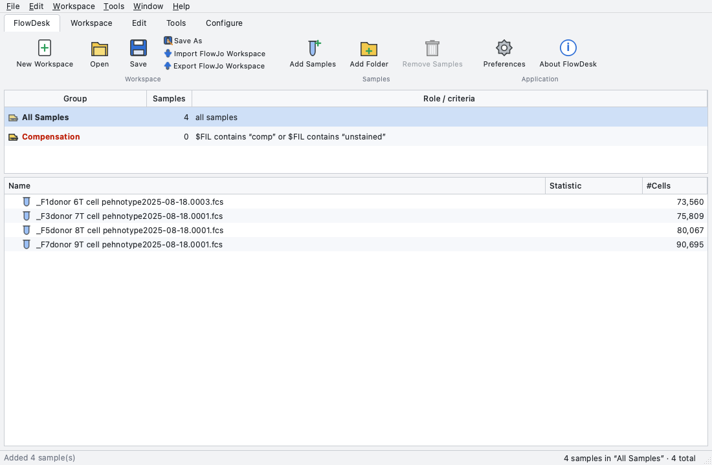 |
| Double-click a sample | A graph window opens on FSC-A vs SSC-A, pseudocolor, with the gate tools in the toolbar, the ancestry strip, axis buttons and `T` buttons. | 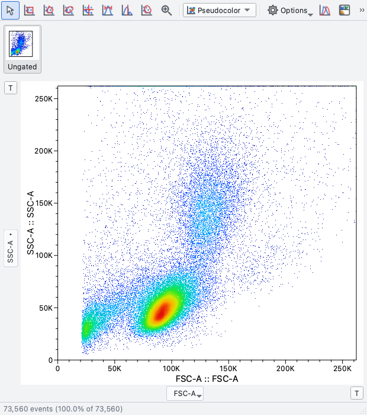 |
| Pick the polygon tool and click around the lymphocytes | Same: click vertices, double-click (or click the first vertex) to close. | 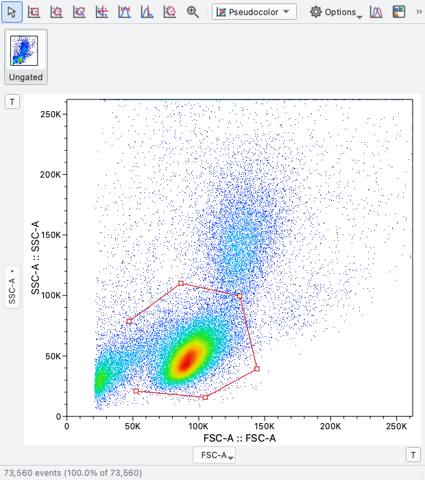 |
| Type the population name in the popup | Same popup, with the familiar default name (`FSC-A, SSC-A subset`) and a box to apply the gate to the current group. | 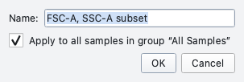 |
| The gate shows its name and frequency | Same. | 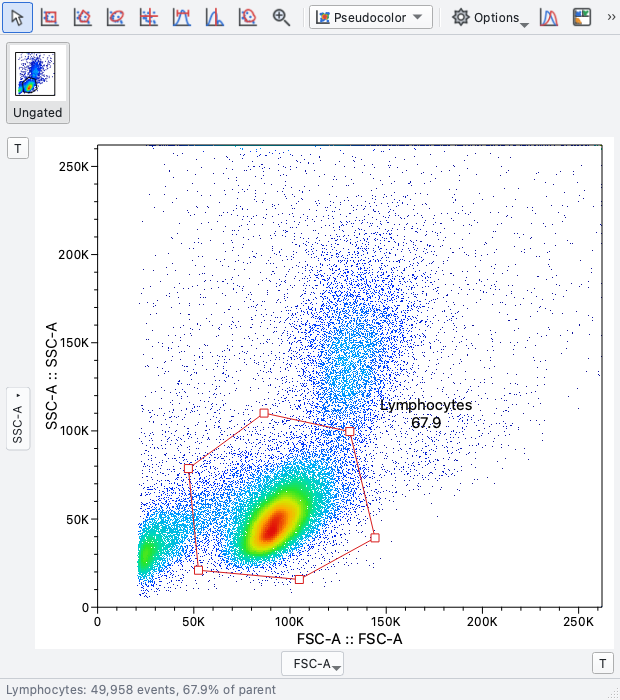 |
| Double-click inside the gate to drill down, choose FSC-A / FSC-H, draw a rectangle | Same; the ancestry strip grows by one thumbnail. | 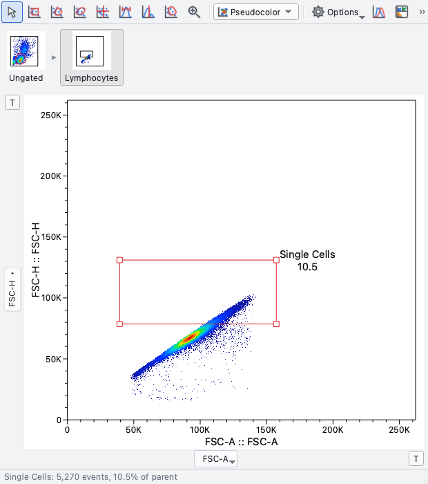 |
| Quadrant tool on the fluorescence axes | Same; `Q1…Q4` labelled with the stains and their frequencies. | 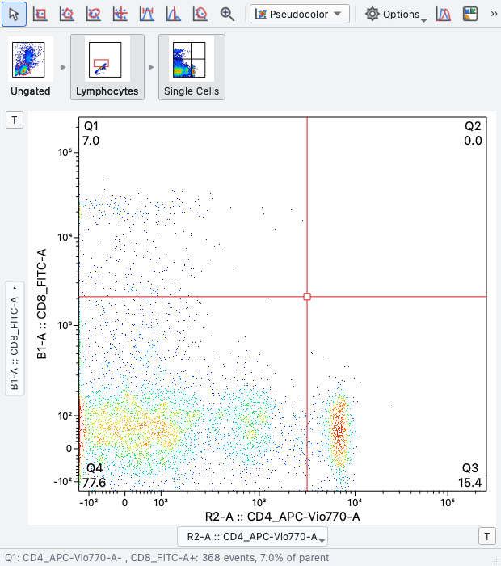 |
| Switch the y-axis to *Histogram* and draw a range gate | Same; the y-axis button offers *Histogram* at the top of the parameter list. | 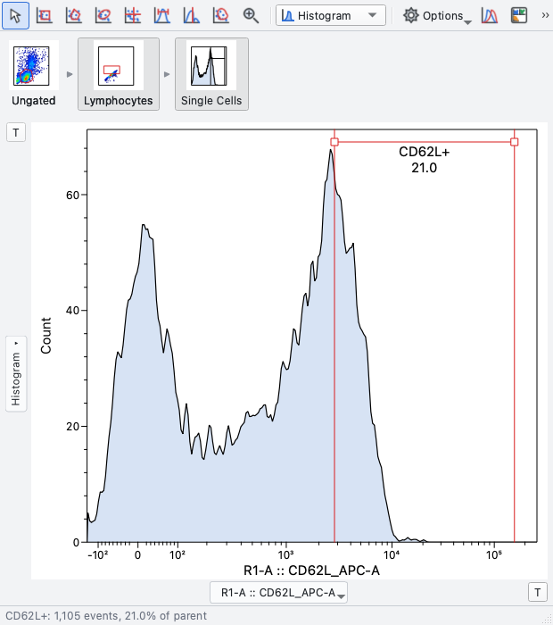 |
| Change the plot type to Contour | Same drop-down: Pseudocolor, Dot, Contour, Zebra, Density, Histogram. | 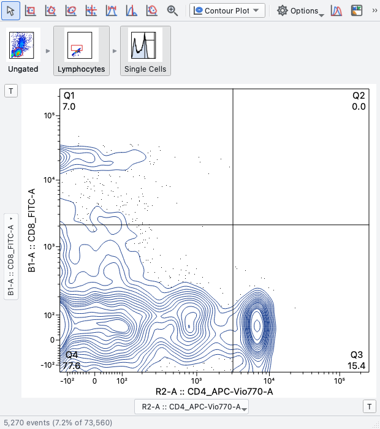 |
| Press the `T` button to adjust the biexponential (width basis, positive/negative decades) | Same `T` button and parameters, with a live preview. | 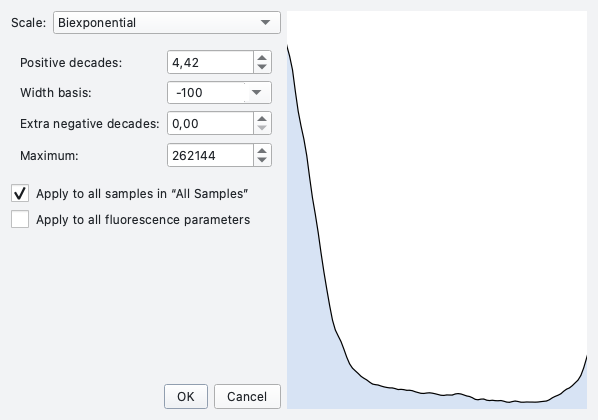 |
| Back in the workspace: the gates applied to the group are on every sample | Same, with per-sample frequencies and counts. | 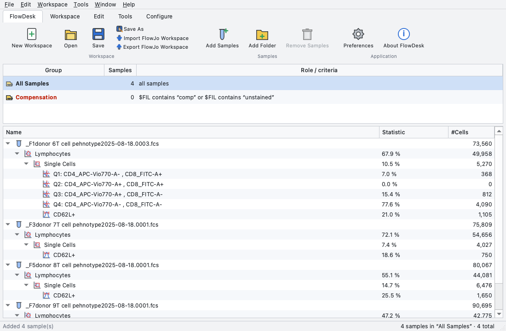 |
| Table Editor: drag populations in, pick statistics, create the table | Same; columns listed as *Population / Statistic / Parameter / Label*. | 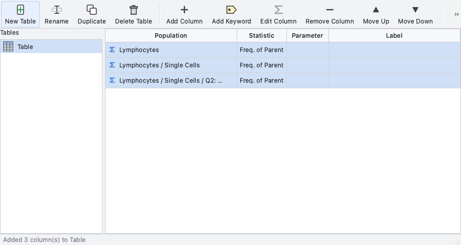 |
| The created table | One row per sample of the group; CSV export and clipboard. | 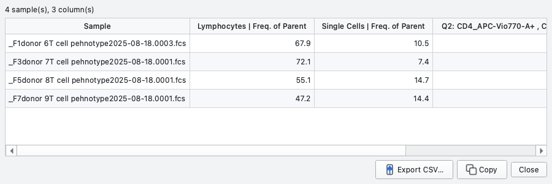 |
| Layout Editor: drag populations onto the page | Same; arrange in a grid, overlays by dropping onto a plot, batch PDF per sample. | 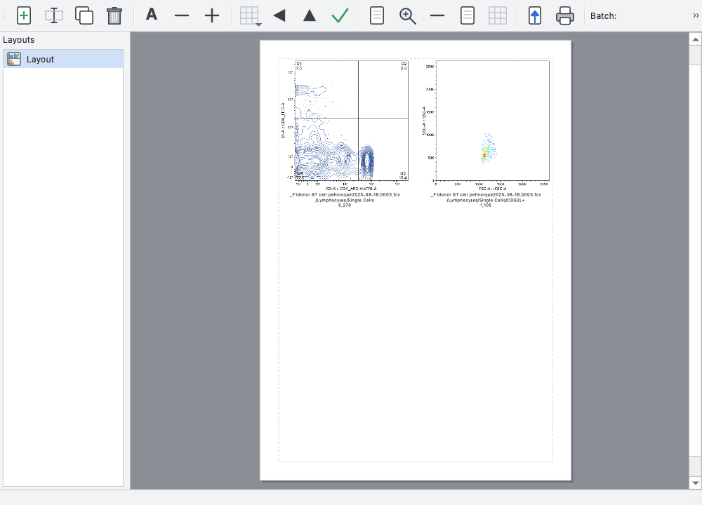 |
| Compensation | Matrix editor, apply to group, wizard from single-stain controls. | 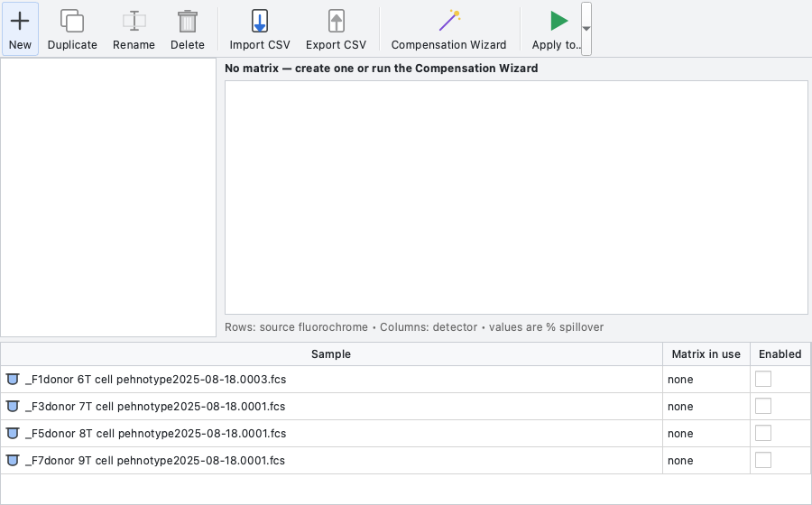 |

## Ten-minute acceptance check (for someone who knows FlowJo)

1. `./flowdesk.sh`, then `File ▸ Open` one of your own `.wsp` files. Expect the
   same groups, samples, gate names and (within ~1 %) the same percentages.
2. Double-click a sample; press `R`, drag a rectangle; name it. Press `V`,
   drag the gate; `⌘Z` to undo.
3. Double-click inside the gate; `⌘→` to cycle the x parameter; pick
   *Histogram* on the y-axis button; press `H` and drag a range gate.
4. Drag the new population from the sample pane onto *All Samples* in the
   group pane: every sample gets it.
5. `⌘T` (Table Editor): drag two populations in, *Create Table*, *Copy*, paste
   into a spreadsheet.
6. `⌘L` (Layout Editor): drag a population onto the page, drop a second one
   onto that plot for an overlay, export a PDF.
7. `File ▸ Export FlowJo Workspace…`, then open the result in FlowJo.

If any step feels different from what your hands expect, that is the gap to
report.
